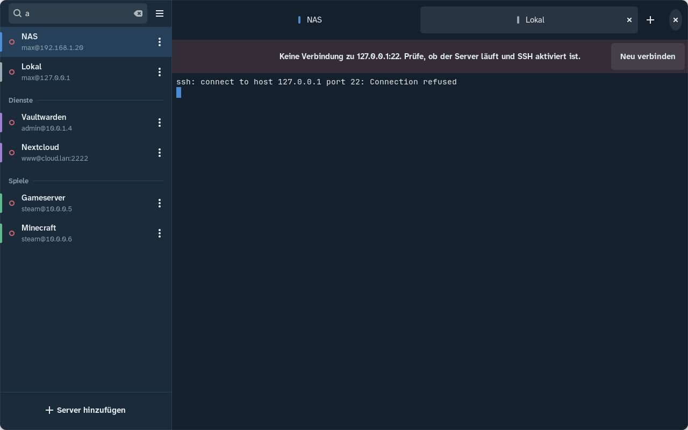
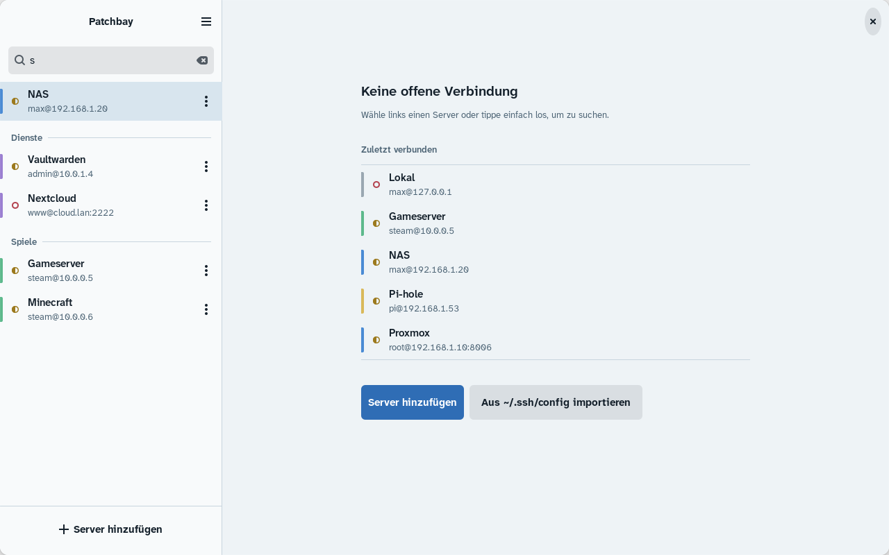
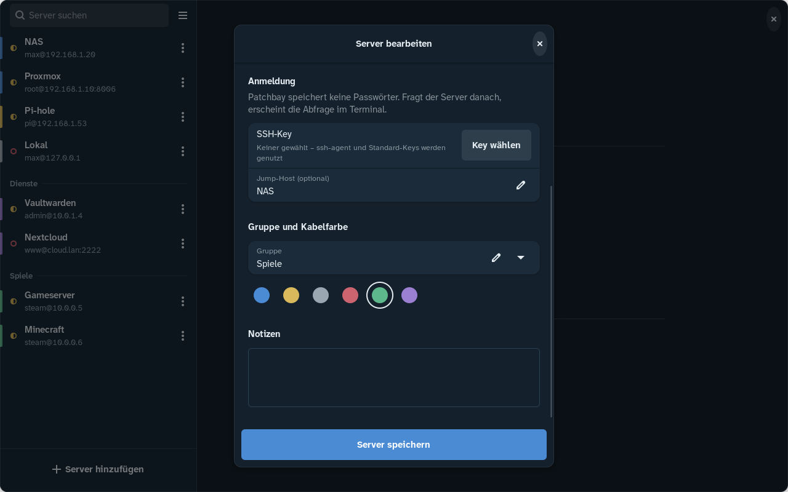
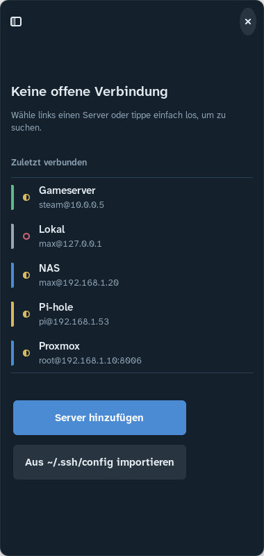

# easyShell

Mit easyShell speicherst und verwaltest du deine Home-Server und verbindest dich mit
einem Klick per SSH. Jeder Server ist ein Port mit Status-LED, jede Gruppe hat eine
Kabelfarbe. Verbindungen öffnen sich als Tabs mit eingebettetem Terminal (VTE).

Python 3 · GTK 4 · libadwaita · VTE (GTK 4) · ausgeliefert als Flatpak (GNOME 51).
Das Design ist in [DESIGN.md](DESIGN.md) beschrieben.



| Hell, mit Suche | Server bearbeiten | Schmal (Deck hochkant) |
|---|---|---|
|  |  |  |

## Flatpak bauen und installieren

Auf Bazzite (oder jedem anderen System mit Flatpak):

```bash
./build-aux/build-flatpak.sh --install
```

Das Skript installiert nichts ins System. Bei Bedarf holt es per `flatpak --user`
die GNOME-51-Runtime, das passende SDK und `org.flatpak.Builder`, baut
`dist/easyshell.flatpak` und installiert das Bundle mit `flatpak install --user`.
Du kannst es auch aus einer Distrobox oder Toolbox starten. Die flatpak-Befehle laufen
dann auf dem Host.

Nur das Bundle bauen und später installieren:

```bash
./build-aux/build-flatpak.sh
```

```bash
flatpak install --user dist/easyshell.flatpak
```

Starten:

```bash
flatpak run io.github.premaxim.EasyShell
```

Nach der Installation steht easyShell auch im App-Menü (KDE und GNOME). Im
Gaming-Modus des Steam Deck fügst du es über „Zu Steam hinzufügen“ im Desktop-Modus hinzu.

## Permissions

| Permission | Wozu |
|---|---|
| `--share=network` | SSH-Verbindungen und der TCP-Check auf den SSH-Port |
| `--socket=ssh-auth` | Reicht `SSH_AUTH_SOCK` durch, damit ssh deinen ssh-agent nutzt (auch KeePassXC oder 1Password als Agent) |
| `--filesystem=~/.ssh` | Keys, `~/.ssh/config` und `known_hosts`. Schreibrecht braucht ssh, um neue Host-Keys in `known_hosts` einzutragen |
| `--socket=wayland`, `--socket=fallback-x11`, `--share=ipc`, `--device=dri` | Normales Fenster mit GPU-Rendering |

**ssh und VTE:** Die GNOME-51-Runtime enthält einen OpenSSH-Client (`ssh`, `ssh-agent`,
`ssh-keygen`), aber weder VTE noch `ssh-copy-id`.
- VTE 0.84 wird im Manifest als eigenes Modul gebaut, mit GTK 4 und ohne GTK 3.
- „Key auf Server kopieren“ braucht kein `ssh-copy-id`. easyShell hängt deinen
  öffentlichen Key per ssh an `~/.ssh/authorized_keys` an, sofern er dort noch fehlt.
  Ein Passwort-Prompt erscheint dabei im Terminal-Tab.

**Fallback auf den Host-ssh:** Findet easyShell in der Sandbox kein `ssh` (etwa mit einer
anderen Runtime), startet es `flatpak-spawn --host ssh …`. Dafür brauchst du
zusätzlich diese Permission:

```bash
flatpak override --user --talk-name=org.freedesktop.Flatpak io.github.premaxim.EasyShell
```

Standardmäßig ist sie nicht gesetzt, weil sie Befehle außerhalb der Sandbox erlaubt.

## Daten

- Die Server liegen in `$XDG_CONFIG_HOME/easyshell/servers.json`, im Flatpak also in
  `~/.var/app/io.github.premaxim.EasyShell/config/easyshell/servers.json`. Die Datei hat
  die Rechte `0600` und wird atomar geschrieben. Ist sie kaputt, sichert easyShell sie als
  `servers.json.defekt-<zeit>` und startet mit einer leeren Liste.
- **Passwörter werden nie gespeichert.** Das Datenmodell hat dafür kein Feld. Die
  Anmeldung läuft über Keys und den ssh-agent. Fragt ein Server nach einem Passwort,
  tippst du es im Terminal ein.

## Bedienung

- Ein Klick auf einen Server (oder Enter) verbindet.
- Rechtsklick, langes Drücken oder ⋮ öffnet das Menü der Zeile: Bearbeiten,
  Duplizieren, Befehl kopieren, Key auf Server kopieren, Löschen (mit Rückgängig).
- Zum Suchen tippst du einfach los oder drückst Strg+F. Gesucht wird in Name, Host,
  Benutzer und Gruppe. Enter verbindet mit dem ersten Treffer.
- Die LED zeigt den Status: gefüllt heißt erreichbar, ein Ring heißt nicht erreichbar,
  halb gefüllt heißt „prüfe…“. Geprüft wird alle 30 s asynchron. Bei Servern mit
  Jump-Host prüft easyShell den ersten Hop.
- Als Jump-Host kannst du `user@host:port` oder den Namen eines gespeicherten
  Servers eintragen.

### Key nach Passwort-Login automatisch übertragen

Meldest du dich bei einem Server per Passwort an, trägt easyShell danach deinen
öffentlichen Key dort ein. Ab der nächsten Verbindung brauchst du kein Passwort mehr.
Das Passwort fragt es dafür nicht noch einmal ab.

1. Jede Sitzung läuft als ssh-ControlMaster mit eigenem Socket unter
   `$XDG_RUNTIME_DIR` (im Flatpak `$XDG_RUNTIME_DIR/app/<App-ID>`). Der Socket
   entsteht erst nach erfolgreicher Anmeldung.
2. Dann baut easyShell im Hintergrund eine zweite Verbindung auf, die nur Keys
   versucht (`BatchMode=yes`, `PreferredAuthentications=publickey`). Klappt sie,
   passiert nichts.
3. Wird sie mit „Permission denied“ abgewiesen, lief der Login per Passwort. Dann hängt
   easyShell den Key über die bestehende Verbindung an `~/.ssh/authorized_keys` an,
   aber nur, wenn er dort noch fehlt. Eine Meldung bestätigt das.

Übertragen wird der `.pub`-Key neben dem SSH-Key des Servers, sonst
`~/.ssh/id_ed25519.pub`, `id_ecdsa.pub` oder `id_rsa.pub`. Hast du keinen Key, weist
easyShell auf `ssh-keygen -t ed25519` hin. Bei Netzwerk- oder Host-Key-Fehlern passiert
nichts. Abschalten kannst du die Funktion im Hauptmenü unter „Key nach Passwort-Login
übertragen“. Ohne Multiplexing (Fallback über `flatpak-spawn --host`) ist sie aus.

### Tastenkürzel

| Kürzel | Aktion |
|---|---|
| Strg+N | Neuer Server |
| Strg+T | Schnell verbinden (`user@host:port` oder Servername) |
| Strg+W | Tab schließen |
| Strg+Bild↑ / Strg+Bild↓ | Tab wechseln |
| Strg+F | Suche |
| Strg+? | Kürzel-Übersicht |
| Strg+Umschalt+C / V | Im Terminal kopieren / einfügen |
| Strg+Plus / Minus / 0 | Terminal-Schrift größer / kleiner / zurücksetzen |

**Hinweis zum Terminal:** Strg+W, Strg+N, Strg+T und Strg+F sind in der Shell belegt
(Wort löschen, History, Zeichen tauschen, vorwärts). Hat das Terminal den Fokus, gehen
diese Tasten an die Shell. Dort greifen Strg+Umschalt+W/N/T/F. Überall sonst
funktionieren die Kürzel ohne Umschalt.

Die Terminal-Schrift (Standard: JetBrains Mono 11) änderst du im Kontextmenü des
Terminals, im Tab-Menü oder im Hauptmenü.

## Entwicklung (Distrobox/Toolbox)

Im Container, zum Beispiel Ubuntu 24.04 oder Fedora:

```bash
sudo apt install python3-gi python3-gi-cairo gir1.2-gtk-4.0 gir1.2-adw-1 gir1.2-vte-3.91 python3-pytest
```

Unter Fedora heißen die Pakete `python3-gobject gtk4 libadwaita vte291-gtk4 python3-pytest`.

```bash
python3 -m easyshell
```

```bash
python3 -m pytest -q
```

Ohne die gebündelten Schriften fällt die Oberfläche auf die System-Sans zurück.

Die Tests decken Storage, den `~/.ssh/config`-Parser (Include, Muster mit Negation,
„erster Wert gewinnt“, Match-Blöcke) und den Aufbau der ssh-Befehle ab.

Für Screenshots ohne sichtbares Fenster gibt es `EASYSHELL_SCREENSHOT=datei.png`, optional
mit `EASYSHELL_SCREENSHOT_SCRIPT=connect:NAS,editor` (siehe `easyshell/devtools.py`).

## Struktur

```
easyshell/
  models.py            Server-Datenklasse, Kabelfarben
  storage.py           JSON-Speicher (atomar, 0600)
  ssh/config_parser.py Import aus ~/.ssh/config
  ssh/connection.py    ssh-Argumente, Befehl kopieren, Key kopieren, Schnellverbinden
  ssh/status.py        asynchroner TCP-Check
  ssh/autokey.py       Key nach Passwort-Login automatisch übertragen
  ui/                  Fenster, Zeilen, Editor, Dialoge, Terminal, Theme
tests/                 pytest
io.github.premaxim.EasyShell.json   Flatpak-Manifest
build-aux/build-flatpak.sh         Build- und Installationsskript
```

Bis Version 0.1 hieß die App „Patchbay“. Liegt noch `~/.config/patchbay/servers.json`
vor, übernimmt easyShell die Liste beim ersten Start (außerhalb des Flatpaks).

Die App-ID `io.github.premaxim.EasyShell` ist ein Platzhalter. Passe sie vor einer
Veröffentlichung an deinen GitHub-Namen an: Manifest, `data/` und `easyshell/__init__.py`.
